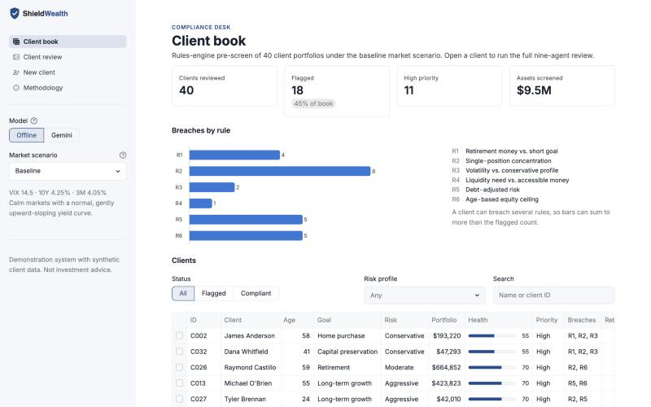
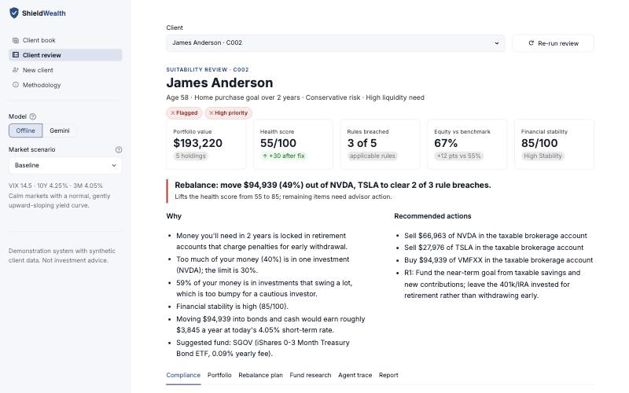

# ShieldWealth

**Nine-agent portfolio suitability and compliance review, built on Google's Agent Development Kit (ADK).**

ShieldWealth reviews a client's portfolio the way a wealth-management compliance desk would. It profiles the client, reads the market, audits the holdings against six suitability rules, proposes a rebalance that it re-audits before recommending, finds matching funds with FAISS retrieval, and writes a plain-language verdict with a downloadable PDF report.

Built for the Google AI Agents Hackathon (2026). All client data is synthetic.




---

## What it does

| Page | Use it to |
|---|---|
| **Client book** | Triage all 40 demo clients at once: who's flagged, which rules break most often, and what it would take to fix each one. Filter by status, risk profile or name. |
| **Client review** | Run the full nine-agent review for one client. Tabs cover the rule-by-rule audit, allocation charts, the proposed rebalance (with before/after re-audit), fund research, the agent trace and the PDF report. |
| **New client** | Enter a profile and holdings and review a client who isn't on file. |
| **Methodology** | See the agents, rules, guardrails and data sources. |

From the sidebar you can:

- **Model:** choose *Offline* (a deterministic stand-in drives every agent, so no API key is needed and no data leaves the machine) or *Gemini* (`gemini-2.5-flash`).
- **Market scenario:** choose *Baseline*, *Volatility shock*, *Inverted curve* or *Live* (Yahoo Finance) to see how market conditions change the risk findings and the strategy.

## Architecture

```
SequentialAgent  wealth_suitability_pipeline
├─ 1 intake_agent                      get_client (MCP) → save_client_profile      → client_profile
├─ 2 market_scout_agent                fetch_market_context                        → market_context
├─ 3 personal_financial_analyst_agent  analyze_financial_stability                 → financial_stability_profile
├─ SequentialAgent  portfolio_review_stage
│  ├─ 4 portfolio_analysis_agent       fetch_and_calculate_portfolio               → portfolio_metrics, holdings
│  ├─ 5 risk_assessment_agent          assess_portfolio_risk                       → risk_flags
│  └─ 6 compliance_agent               evaluate_compliance_rules                   → compliance_result
├─ 7 planning_strategy_agent           get_strategy_baseline → save_planning_strategy → rebalance_plan, planning_strategy
├─ 8 product_research_agent            query_product_research (FAISS)              → product_research_result
└─ 9 advisor_summary_agent             draft_advisor_summary → save_final_summary  → final_summary
```

Agents never call each other. Each one reads and writes typed keys in the shared ADK session state.

**The numbers come from code, not the model.** Every calculation (allocations, rule verdicts, health score, priority, trades) lives in [`app/engine.py`](app/engine.py). The LLM decides which tools to call and writes the client-facing language. `save_final_summary` compares the model's output with the engine's draft and puts back any computed field the model changed. The UI shows each correction it makes.

| Module | Responsibility |
|---|---|
| `app/agent.py` | The nine agents and their tools; `build_pipeline(model)` |
| `app/engine.py` | Deterministic rules engine: metrics, rules R1–R6, stability, risk, rebalancing, summary drafts |
| `app/rag.py` / `setup_rag.py` | Fund-prospectus FAISS index (24 funds), filtered by risk profile |
| `app/offline_llm.py` | Deterministic `BaseLlm` that drives the same tools with no API calls |
| `app/pipeline.py` | Runs a review and records a step-by-step trace |
| `app/report.py` | PDF report built from session state |
| `mcp_server.py` | FastMCP server; one client per call, with client ID validation |
| `streamlit_app.py`, `ui/` | Advisor console |

## Suitability rules

Thresholds live in [`data/suitability_rules.json`](data/suitability_rules.json) and personalise to each client.

| Rule | Flags when | Fixable by trading? |
|---|---|---|
| R1 · Retirement money vs. short goal | Horizon ≤ 3 years, money sits in 401(k)/IRA, the client is under 59½ at the goal date, and money reachable without penalty is less than the goal amount | No: advisor action |
| R2 · Single-position concentration | One stock or narrow fund > 30% (cash and broad index funds exempt) | Yes: trim to 25% |
| R3 · Volatility vs. conservative profile | Conservative client with > 15% in high-volatility holdings | Yes: trim to 10% |
| R4 · Liquidity need vs. accessible money | High liquidity need and < 25% in savings, checking or taxable accounts | No: advisor action |
| R5 · Debt-adjusted risk | Non-mortgage debt > $20k and > 20% high-volatility | Yes: trim to 15% |
| R6 · Age-based equity ceiling | Age ≥ 55 and equity > age benchmark + 15 pts | Yes: trim to benchmark + 10 |

**Health score** is 100 minus 15 for each breached rule.

**Priority** is:
- *High* for two or more breaches, or any breach of R3, R5 or R6
- *Medium* for a single other breach
- *Low* when the portfolio is compliant

**Rebalancing** trims the positions behind each breach and reinvests inside the same account, so no withdrawals are implied. It then re-audits the result, up to four passes. R1 and R4 depend on which account the money is in, so they come back as advisor actions rather than trades.

## Demo data

The book has 40 synthetic clients chosen to cover distinct situations:

- James Anderson (C002) is buying a home in 2 years with tech stocks. He'll be 60 by then, so his 401(k) money isn't penalised (R1 passes).
- Grace Nguyen (C012) is saving for a $60,000 down payment in 3 years but has only about $31,000 outside her retirement accounts (R1).
- Raymond Castillo (C026) holds concentrated employer stock near retirement.
- Tyler Brennan (C027) is a crypto-heavy 24-year-old carrying debt.
- Margaret Ellison (C028) is a widow with a high liquidity need and most of her money in a 401(k).
- Dr. Amara Nwosu (C037) carries large student loans and holds high-volatility stock.
- Sophie & Luke Martin (C038) are buying a home next year, fully in cash and T-bills.
- Jordan Ellis (C036) is aggressive on paper but 85% in cash: they pass compliance but are flagged by the risk check.

Prices are a fixed snapshot in [`data/ticker_reference.json`](data/ticker_reference.json).

## Run it

Requires Python 3.11–3.13 and [uv](https://github.com/astral-sh/uv).

```bash
uv sync
uv run streamlit run streamlit_app.py
```

Open http://localhost:8501. It works without an API key. To use Gemini, copy `env.example` to `.env` and set `GOOGLE_API_KEY`.

To run the pipeline directly:

```python
from app.pipeline import run_review
result = run_review("C002", mode="offline", market_scenario="inverted")
print(result.state["final_summary"]["headline"])
```

After editing `data/fund_corpus.json`, rebuild the fund index:

```bash
uv run python setup_rag.py
```

### Docker

```bash
docker build -t shieldwealth .
docker run -p 8501:8501 --env-file .env shieldwealth
```

## Tests

```bash
uv run pytest
```

The suite has 122 tests and runs offline in about 5 seconds:

- **Unit:** rule boundaries (including exact-threshold cases), metrics, scoring, stability and risk checks, rebalance properties across every demo client, summary guardrails, dataset integrity, MCP access controls, retrieval quality and determinism, and PDF generation.
- **Integration:** all 40 clients through the full nine-agent ADK pipeline. Pipeline output must equal a direct engine computation. Also covers custom clients, market scenarios and unknown-client handling.
- **UI:** every Streamlit page rendered headlessly with `AppTest`.

The live Gemini and server tests are skipped by default. Run them with `RUN_LIVE_TESTS=1` and a valid `GOOGLE_API_KEY`.

## Limitations

- Client data, prices and the fund corpus are synthetic or fixed snapshots. This is a demonstration, not investment advice.
- Fund retrieval uses a local hashing embedder so results are reproducible and offline. A hosted embedding model would match on meaning better.
- Rebalancing ignores tax lots, transaction costs and wash-sale rules.

`docs/hackathon/` keeps the original hackathon submission write-up and diagrams.
